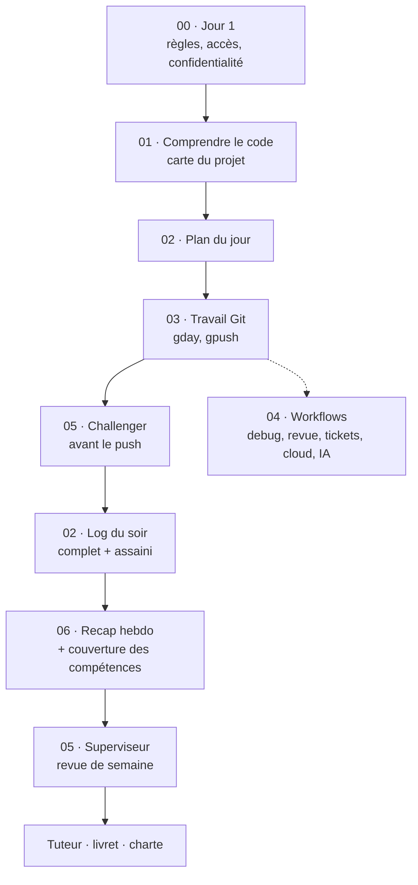

# mission-kit

Ma boîte à outils pour arriver prêt sur une mission et y travailler proprement : comprendre du code que je n'ai pas écrit,
organiser ma journée, utiliser Git sans risque, et garder une trace utile pour mon tuteur, mon livret de suivi CESI et ma charte.

Tout le kit tient dans des fichiers texte : prompts à donner à un assistant (Copilot dans VS Code, ou un chat), scripts, guides et modèles.

## Les six principes

1. **J'écris une fois, le reste en découle.** Un log du soir produit le recap de la semaine, la couverture des compétences et les brouillons du livret.
2. **L'IA propose, je vérifie.** Chaque réponse distingue [vu dans le code], [déduit] et [inconnu]. Aucun prompt n'a le droit d'inventer un fait, une durée ou une preuve.
3. **Trois zones, jamais mélangées.** Générique (le kit), travail (logs complets, cartes, notes sur le code), assaini (version qui peut sortir).
4. **Jamais sur la production.** Branches, pull requests, lecture seule d'abord pour l'infrastructure, actions destructives seulement avec accord.
5. **Les règles du client passent avant les miennes.** Conventions Git, outils autorisés, ce que je peux écrire : je demande le jour 1.
6. **Les humains évaluent.** Mon tuteur note mes compétences, le relecteur du client valide mon code. Aucun agent ne fait ça à leur place.

## La carte du kit

    mission-kit/
    ├── README.md                      ce fichier
    ├── setup.sh                       prépare une nouvelle machine (PATH, dossiers, droits, vérifications)
    ├── check-kit.sh                   contrôle qualité du kit (shellcheck, syntaxe, fins de ligne, fichiers sensibles)
    ├── 00-start-here/                 le jour 1
    │   ├── day1-playbook.md           la page de lancement, à suivre dans l'ordre
    │   ├── day1-questions.md          les questions à poser (cadre, accès, Git, sécurité, CESI)
    │   ├── first-3-hours.md           comprendre une pile inconnue sans rien casser
    │   └── confidentiality-checklist.md   ce que je peux coller dans un outil d'IA, et ce que je ne peux pas
    ├── 01-understand-codebase/        comprendre un dépôt existant
    │   ├── core/                      map-the-repo, run-locally, read-the-history, architecture-summary,
    │   │                              big-picture, who-owns-what, tech-debt-and-risks
    │   ├── big-picture-questions.md   guide d'entretien pour la vue d'ensemble métier
    │   ├── codebase-map-template.md   la carte du projet à remplir
    │   └── module-rag-ai.md, module-cloud.md, module-unknown-stack.md
    ├── 02-daily/                      la journée
    │   ├── start-of-day / plan-my-day / end-of-day (.prompt.md)
    │   ├── daily-log-template.md      le format du log
    │   └── competences.md             les 12 compétences du livret et les aptitudes
    ├── 03-git/                        Git sans danger
    │   ├── gday                       commit conventionnel en une commande, refuse les branches protégées
    │   ├── gpush                      push sécurisé de la branche courante + lien de PR
    │   ├── install-guard.sh, hooks/   garde-fou local (pas de commit ni de push sur main/prod, pas de secrets)
    │   └── branches-from-zero.md, pr-workflow.md, oops-recipes.md
    ├── 04-workflows/                  les situations courantes
    │   ├── general/                   revue de code, débogage, tickets, documentation, ADR, démo, aide, réunions
    │   ├── ai-rag/                    évaluer un RAG, diagnostiquer une mauvaise réponse, versionner les prompts, coût
    │   └── cloud/                     revue des coûts, changement Terraform, relecture de plan, schéma, retour d'incident
    ├── 05-agents/                     les relecteurs et les règles permanentes
    │   ├── challenger.agent.md        cherche les failles dans un plan, un script, un diff, un prompt
    │   ├── supervisor.agent.md        regard de senior sur ma journée, ma branche, ma progression
    │   ├── pre-push-check.prompt.md   le Challenger appliqué à ma branche avant chaque push
    │   └── copilot-instructions.md    règles toujours actives (+ comment les installer)
    ├── 06-recaps/                     le suivi
    │   ├── newlog                     crée le log du jour
    │   ├── sanitize / weekly-recap / competence-coverage / monthly-rollup (.prompt.md)
    │   ├── livret-draft / charte-chantier (.prompt.md)
    │   └── weekly-routine.md          quoi faire, quand, et où vit chaque fichier
    ├── tests/e2e/                     semaine fictive, scanner de fuites, grille de vérification
    ├── 06-logs/        (hors Git)     mes données : daily/ sanitized/ weekly/ monthly/ cesi/
    └── missions/       (hors Git)     le contexte de chaque mission, sur le poste de travail seulement

Les dossiers `06-logs/` et `missions/` sont dans `.gitignore` : rien de ce qu'ils contiennent ne doit jamais partir sur GitHub.

## Comment tout s'enchaîne

Le fil conducteur : le **log du soir** (partie A, complète, reste sur le poste ; partie B, assainie, peut sortir si la règle l'autorise).
Tout ce qui est hebdomadaire, mensuel, livret ou charte se construit à partir de la partie B.

## Installer le kit sur une machine

**Mon PC perso (WSL)**

    git clone git@github.com:Vanelfokamcode/mission-kit.git ~/mission-kit
    cd ~/mission-kit
    ./setup.sh            # vérifie, ne change rien
    ./setup.sh --apply    # ajoute le PATH, crée 06-logs/, met les droits d'exécution
    source ~/.bashrc
    ./check-kit.sh        # tout doit être au vert

S'il existe une ancienne fonction `gday` dans `~/.bashrc`, elle masque le script : ajouter `unset -f gday` à la fin du fichier.
Chaque machine a sa propre clé SSH ajoutée à GitHub ; on ne copie jamais une clé privée.

**Le PC pro**
1. Je n'y utilise ni mon compte GitHub perso ni mon compte IA perso. Je ne clone donc pas ce dépôt sans autorisation explicite.
2. Je demande à mon tuteur : où mettre mon kit (fichiers génériques), quels outils d'IA sont autorisés, sur quelles données.
3. Une fois le kit en place : `./setup.sh --apply`, puis dans chaque dépôt client : `git config user.email` avec l'e-mail de l'entreprise,
   `install-guard.sh` seulement si le dépôt n'a pas ses propres hooks, et `git config mission.protectedBranches "..."` si besoin.
4. Règles permanentes Copilot au niveau du profil utilisateur, jamais dans le dépôt du client : `05-agents/copilot-instructions-install.md`.
5. Pas de synchronisation des paramètres VS Code avec un compte perso.
6. Le kit se modifie sur mon PC perso. Le PC pro le reçoit ; rien de ce qui est créé au travail ne remonte vers le dépôt perso.

## Utiliser le kit, pour de vrai

### Avant de démarrer une mission
Ouvrir `00-start-here/day1-playbook.md` et le suivre dans l'ordre : la veille (kit à jour, questions préparées), le matin (règles, accès, verrou
confidentialité), l'après-midi (cloner, régler l'identité Git, cartographier, lancer en local), le soir (log). Il prévoit aussi les cas
où ça se passe mal (pas d'accès, référent absent, dépôt énorme, pression pour livrer vite).

### Une journée type

| Moment | Je fais | Fichiers |
|--------|---------|----------|
| Avant 9h | `newlog`. `git switch main && git pull`. Je donne à l'assistant la section "Demain" du log d'hier | `06-recaps/newlog`, `02-daily/start-of-day` |
| Stand-up | Je note qui fait quoi et le vocabulaire de l'équipe | |
| Après le stand-up | Je transforme ma todo en planning 9h-17h réaliste. Option : le Superviseur critique le plan | `02-daily/plan-my-day`, `05-agents/supervisor` |
| Pendant le travail | Ticket flou : `write-ticket`. Code inconnu : `01-understand-codebase/core/`. Bug : `debug`. Bloqué 30 minutes : `ask-for-help`. Une branche par ticket ; sur `main`, `gday` m'en propose une | `04-workflows/`, `03-git/` |
| Commits | `gday fix "description courte"` : un commit, un sujet | `03-git/gday` |
| Avant chaque push | Le Challenger relit ma branche, puis `gpush`, puis la PR | `05-agents/pre-push-check`, `03-git/gpush`, `pr-workflow.md` |
| PR des autres, commentaires reçus | `review-code-give`, `review-code-receive` | `04-workflows/general/` |
| 16h30 | `end-of-day` : partie A dans `06-logs/daily/AAAA-MM-JJ.md`, partie B dans `06-logs/sanitized/`. `sanitize` en deuxième passe si je doute | `02-daily/end-of-day`, `06-recaps/sanitize` |

### Une semaine
Le vendredi, 20 minutes (détail dans `06-recaps/weekly-routine.md`) :
1. `weekly-recap` à partir des logs assainis : une page pour mon tuteur.
2. `competence-coverage` : où j'en suis sur les 12 compétences, quelles preuves sont solides ou faibles, ce qu'il faut chercher la semaine suivante.
3. Le Superviseur relit le recap et la couverture et prépare mes questions pour le tuteur.
4. J'envoie le recap, au rythme que mon tuteur préfère (à lui demander).
Une semaine d'école sur quatre : pas de log de mission. Le recap couvre les semaines en entreprise.

### Un mois, un semestre
- Chaque mois : `monthly-rollup` (savoir-faire pratiqués, preuves, objectifs du mois suivant).
- Avant chaque point semestriel : `monthly-rollup` en mode semestre. Je prépare les meilleures preuves par compétence et ce qui manque.
  La notation (A, B, C, D, SO) est celle de mon tuteur, jamais la mienne ni celle d'un agent.

### Le livret de suivi et la charte du chantier
- **Livret** : `livret-draft` produit des brouillons des textes ("missions en entreprise", commentaires par activité, synthèse). Je les relis et je les valide
  avec mon tuteur. Il n'écrit jamais les notes, les appréciations ni les signatures.
- **Charte** : `charte-chantier` procède par questions, rubrique par rubrique, une fois que je suis staffé et que le sujet est possible dans ma mission.
  Le sujet envisagé est un petit projet de gestion de projet, à définir avec mon tuteur et à faire valider par mon ERP.
- Si l'outil n'est pas autorisé pour mes logs de mission, je remplis les documents à la main en m'appuyant sur le recap hebdomadaire.

## Je suis dans telle situation, j'ouvre tel fichier

| Situation | Fichier |
|-----------|---------|
| Je démarre sur une mission | `00-start-here/day1-playbook.md` |
| Je ne sais pas quoi demander | `00-start-here/day1-questions.md` |
| Puis-je coller ça dans un outil d'IA ? | `00-start-here/confidentiality-checklist.md` |
| Dépôt inconnu | `01-understand-codebase/core/map-the-repo`, puis `run-locally`, `architecture-summary` |
| Pourquoi ce système existe, pour qui | `core/big-picture` et `big-picture-questions.md` |
| Pile technique inconnue | `00-start-here/first-3-hours.md`, `module-unknown-stack.md` |
| Projet IA ou RAG | `module-rag-ai.md`, `04-workflows/ai-rag/evaluate-rag`, `rag-debug` |
| Infrastructure cloud | `module-cloud.md`, `04-workflows/cloud/` |
| Planifier ma journée | `02-daily/plan-my-day` |
| Faire un commit, pousser | `gday`, `gpush` |
| Je ne comprends pas les branches | `03-git/branches-from-zero.md` |
| J'ai fait une erreur Git | `03-git/oops-recipes.md` |
| Ouvrir ou mettre à jour une PR | `03-git/pr-workflow.md` |
| Relire une PR, répondre à des commentaires | `04-workflows/general/review-code-give`, `review-code-receive` |
| Un bug | `04-workflows/general/debug` |
| Comprendre ou écrire un ticket | `04-workflows/general/write-ticket` |
| Documenter, consigner une décision | `write-doc`, `adr` |
| Point d'avancement, démo | `status-update-demo` |
| Je suis bloqué depuis 30 minutes | `ask-for-help` |
| Compte rendu de réunion | `meeting-notes` |
| Mauvaise réponse d'un RAG | `ai-rag/rag-debug` |
| Changer l'infrastructure | `cloud/terraform-safe-change.md`, puis `terraform-plan-review` |
| Coûts cloud ou coût par requête IA | `cloud/cost-review`, `ai-rag/cost-tracking` |
| Schéma d'architecture | `cloud/architecture-diagram` |
| Incident | `cloud/postmortem` |
| Avant de pousser | `05-agents/pre-push-check` |
| Un texte doit sortir du poste | `06-recaps/sanitize` |
| Où j'en suis sur les compétences | `06-recaps/competence-coverage` |
| Livret, charte, bilan | `livret-draft`, `charte-chantier`, `monthly-rollup` |
| Nouvelle machine | `setup.sh` |
| Je modifie le kit | `check-kit.sh`, une branche, une PR |

## Les agents et le choix du modèle
- **Challenger** : relecteur adverse. Il cherche ce qui est faux, risqué, oublié ou non prouvé, et doit contredire quand c'est nécessaire.
- **Superviseur** : regard d'un senior bienveillant sur mon plan, ma branche, les conventions du client et ma progression.
- Ils lisent, ils ne modifient rien. Les noms, les emplacements et les outils dépendent de la version de VS Code et des réglages de l'entreprise.
- Règle de choix : celui qui relit ne doit pas être celui qui a produit le travail ; si possible, un modèle d'une autre famille.
  Modèle le plus capable pour la supervision et le Challenger, modèle léger pour la mise en forme des logs.
- Détail : `05-agents/how-to-run.md`.

## Les zones et les règles de confidentialité

| Zone | Contenu | Où ça vit | Peut sortir ? |
|------|---------|-----------|---------------|
| Générique | prompts, scripts, guides, modèles | `mission-kit/` (versionné) | oui |
| Travail | log complet, carte du projet, notes sur le code, contexte de mission | `06-logs/daily/`, `missions/` sur le poste | non |
| Assaini | log sans nom, URL, ticket, code ni donnée | `06-logs/sanitized/` | seulement si la règle de l'entreprise l'autorise |

Je ne suis pas juriste : les règles d'Accenture et du client priment. En cas de doute, je ne copie pas, je ne sors pas, je demande.
Si je me trompe (j'ai collé quelque chose que je n'aurais pas dû), je le dis tout de suite à mon tuteur.

## Maintenir le kit
- Je modifie le kit sur mon PC perso, sur une branche : `gday`, `./check-kit.sh`, `gpush`, PR, merge.
- Un prompt ou un agent commence par une zone de métadonnées avec `description:`, vérifiée par `check-kit.sh`.
- Avant d'adopter un nouveau script ou prompt : le Challenger le relit, puis je le teste sur des données fictives (`tests/e2e/`).
- `tests/e2e/` contient une semaine fictive, un scanner de fuites (`scan-leaks.sh`) et une grille de vérification : je les rejoue après chaque
  changement de `sanitize`, `weekly-recap` ou `competence-coverage`. Le scanner ne vérifie que les données fictives, jamais des données réelles.
- Les sorties de test vont dans `tests/e2e/out/` (hors Git).

## Dépannage rapide

| Symptôme | Cause probable | Remède |
|----------|----------------|--------|
| `gday` pose des questions de l'ancienne version | une fonction dans `~/.bashrc` masque le script | `unset -f gday` à la fin de `~/.bashrc`, puis `type -a gday` |
| `command not found: gday` | PATH absent | `./setup.sh --apply`, puis `source ~/.bashrc` |
| Le commit est bloqué | branche protégée ou fichier qui ressemble à un secret | créer une branche ; retirer le fichier de l'index (`git restore --staged <fichier>`) |
| Le push est refusé | cible protégée, ou le serveur a des commits que je n'ai pas | `git pull`, puis `gpush` ; jamais de force push |
| `$'\r': command not found` | fins de ligne Windows dans un script | `./check-kit.sh` le signale ; reconvertir en fins de ligne Unix |
| `git switch` n'existe pas | Git trop ancien | mettre Git à jour (au moins 2.23) |
| Le kit n'a plus `06-logs/` après un clone | normal : il est hors Git | `./setup.sh --apply` |
| Copilot n'applique pas mes règles | emplacement ou réglages différents sur cette version | `05-agents/copilot-instructions-install.md` |

## Ce que le kit ne fait pas
- Il ne remplace ni mon tuteur, ni la relecture de PR du client, ni les règles de sécurité de l'entreprise.
- Il ne note pas mes compétences et ne signe rien à ma place.
- Il ne garantit pas que l'assistant a raison : tout ce qu'il affirme sur du code se vérifie dans le code.
- Les hooks Git sont un frein local, contournable ; la vraie protection est celle du serveur (protection de branche).
- Il ne dit pas ce que l'entreprise autorise : c'est à confirmer avec mon tuteur, avant d'utiliser quoi que ce soit sur du code client.

## À faire dès que j'ai mon poste de travail
- [ ] Demander à mon tuteur : outils d'IA autorisés et modèles, données autorisées, emplacement du kit sur le poste.
- [ ] Installer le kit à l'endroit validé, puis `./setup.sh --apply`.
- [ ] Installer les règles permanentes Copilot au niveau du profil, et passer les quatre tests de vérification.
- [ ] Régler l'e-mail de l'entreprise dans chaque dépôt client avant le premier commit.
- [ ] Préparer le message du jour 1 pour mon tuteur (modèle dans `day1-questions.md`).
